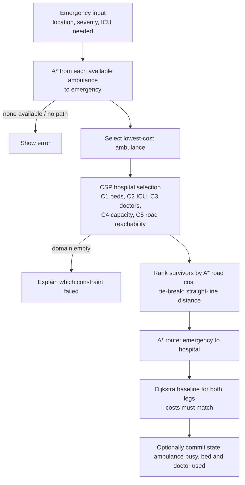

# 🚑 AI-Based Emergency Ambulance Dispatch & Hospital Optimization System

A Python and Streamlit application that dispatches ambulances through a simulated city road network and assigns each patient to a suitable hospital. It combines classical AI techniques: **A\* search**, **Dijkstra's algorithm**, a **Constraint Satisfaction Problem (CSP)** solver, **Mamdani fuzzy logic** and a **Bayesian network**.

> **Simulation notice:** this is an educational simulation. Traffic, rain and accident inputs are **simulated** (set by the user or randomised in the UI), and the Bayesian probabilities are **manually specified, not trained on real data**. The system does not use live traffic, weather or accident feeds.

---

## Table of Contents

- [Features](#features)
- [How It Works](#how-it-works)
- [Project Structure](#project-structure)
- [Installation](#installation)
- [Using the Dashboard](#using-the-dashboard)
- [Sample Data](#sample-data)
- [Algorithm Details](#algorithm-details)
- [Testing](#testing)
- [Limitations](#limitations)
- [Tech Stack](#tech-stack)
- [License](#license)

---

## Features

- **Nearest-ambulance selection:** runs A\* from every available ambulance to the emergency and picks the lowest-cost route.
- **CSP hospital assignment:** filters hospitals by beds, ICU, doctors, capacity limit and road reachability, then picks the one with the lowest road cost. Straight-line distance is only a tie-breaker.
- **Two-leg route planning:** ambulance → emergency, then emergency → hospital, with a combined total cost.
- **Dijkstra baseline:** both route legs are compared against Dijkstra on the same weights. Costs must match, and the dashboard shows how many nodes A\*'s heuristic saves.
- **Fuzzy logic congestion model (optional):** turns a road's traffic factor and a simulated speed ratio into a congestion score that becomes a cost multiplier.
- **Bayesian road-risk model (optional):** estimates the probability that a road is blocked from traffic level, simulated rain and simulated accidents.
- **Independent toggles:** fuzzy and Bayesian features can be switched on and off separately. With both off, the original `distance × traffic_factor` cost is restored exactly.
- **Live system state:** a committed dispatch marks the ambulance busy and admits the patient, so later dispatches see the updated fleet and hospital capacity.
- **Rich visualisations:** city map, A\* exploration, CSP domain reduction, backtracking steps, constraint table and final assignment table.
- **Edge-case handling:** no available ambulance, unreachable emergency, no feasible hospital and an unreachable hospital (with fallback to the next best) all produce clear messages.

---

## How It Works



### Road cost

Every search (A\*, Dijkstra and the CSP's reachability and ranking) reads the same effective edge weights:

```
effective_weight = base_distance × congestion_factor × risk_factor
```

| Fuzzy | Bayesian | `congestion_factor` | `risk_factor` |
|:-----:|:--------:|---------------------|---------------|
| off | off | raw `traffic_factor` | 1.0 |
| on | off | fuzzy-derived | 1.0 |
| off | on | raw `traffic_factor` | `1 + penalty × P(blocked)` |
| on | on | fuzzy-derived | `1 + penalty × P(blocked)` |

With both features off, this reduces to the original `weight = base_distance × traffic_factor`.

---

## Project Structure

```
.
├── app.py                      # Streamlit dashboard and dispatch workflow
├── requirements.txt
├── algorithms/
│   ├── astar.py                # A*, Dijkstra, A*/Dijkstra comparison helper
│   ├── csp.py                  # Hospital-selection CSP (C1–C5, road-cost ordering)
│   ├── fuzzy_logic.py          # Mamdani fuzzy congestion model
│   ├── bayesian_reasoning.py   # Bayesian road-blockage model
│   └── cost_integration.py     # Combines fuzzy + Bayesian into edge weights
├── models/
│   ├── city_graph.py           # NetworkX-backed road network
│   ├── hospital.py             # Hospital resources and capacity rules
│   └── ambulance.py            # Ambulance state
├── data/
│   └── city_data.py            # Sample city, hospitals, ambulances, traffic helpers
├── visualization/
│   ├── graph_viz.py            # Map, A* exploration, A*/Dijkstra comparison
│   └── csp_viz.py              # CSP charts and tables
└── tests/
    ├── test_fuzzy_bayesian.py  # Fuzzy, Bayesian, cost integration, integration tests
    └── test_dispatch_fixes.py  # Optimality, CSP, state and dashboard regression tests
```

---

## Installation

**Requirements:** Python 3.8 or newer (developed and tested on 3.12) and `pip`.

```bash
# 1. Clone
git clone https://github.com/<your-username>/AI-Based-Emergency-Optimization-System.git
cd AI-Based-Emergency-Optimization-System

# 2. (Recommended) create a virtual environment
python -m venv venv
source venv/bin/activate        # macOS / Linux
venv\Scripts\activate           # Windows

# 3. Install dependencies
pip install -r requirements.txt

# 4. Run
streamlit run app.py
```

Then open <http://localhost:8501>.

---

## Using the Dashboard

### 🆘 Emergency Dispatch
1. Pick a ready-made scenario or choose the emergency **location**, **severity** and whether an **ICU** is required.
2. Leave **Commit dispatch** ticked to mark the chosen ambulance busy and admit the patient, or untick it for a dry run that changes nothing.
3. Click **DISPATCH AMBULANCE**. You will see, in order:
   - the selected ambulance and the A\* exploration;
   - the A\* vs Dijkstra comparison for leg 1;
   - the assigned hospital, its route and the total cost;
   - the A\* vs Dijkstra comparison for leg 2;
   - the CSP constraint table, domain reduction, backtracking steps and final assignment.

### 🏥 Hospital Management
View beds, doctors, ICU status, occupancy and capacity limit for each hospital, and edit them to see how decisions change.

### ⚙️ System Administration
- **Traffic:** randomise all roads, reset them to 1.0×, or set individual roads manually (1.0×–3.0×).
- **AI-Enhanced Routing:** toggle Fuzzy Logic and Bayesian Reasoning independently. For Bayesian, tick simulated *Rain* and *Accident* evidence and set the risk penalty weight. A live inspector shows the fuzzy score and blockage probability for any traffic value.
- **Fleet:** see ambulance status, **Release All Ambulances**, or **Reset Fleet & Hospitals to Defaults**.

> The sample data has three available ambulances. With **Commit dispatch** on, a fourth dispatch reports "No ambulances available" until you release them.

---

## Sample Data

A 20-intersection city (nodes `A`–`T`) with 36 roads.

| Hospital | Node | Total beds | Available | ICU | Doctors | Capacity limit |
|----------|:----:|:----------:|:---------:|:---:|:-------:|:--------------:|
| City General Hospital | C | 50 | 12 | ✅ | 8 | 45 |
| St. Mary's Medical Center | H | 30 | 5 | ✅ | 4 | 27 |
| Emergency Care Hospital | N | 40 | 15 | ❌ | 6 | 36 |
| National Trauma Center | P | 60 | 20 | ✅ | 10 | 54 |
| Westside Clinic | E | 20 | 3 | ❌ | 2 | 18 |

| Ambulance | Start node | Status |
|-----------|:----------:|--------|
| AMB-01 | A | Available |
| AMB-02 | J | Available |
| AMB-03 | T | Available |
| AMB-04 | M | Busy |

---

## Algorithm Details

### A\* and Dijkstra
- A\* uses `f(n) = g(n) + h(n)` with straight-line distance as `h`. This is admissible because every effective weight is at least the straight-line distance (traffic factors are ≥ 1.0).
- Dijkstra is the same search with `h = 0`. Both use a priority queue with lazy deletion, so an improved path to a node already queued is always re-queued, and stale entries are skipped.
- The results are checked against NetworkX's shortest path in the test suite.

### CSP hospital selection
- **Variable:** the hospital assigned to this emergency. **Domain:** all hospitals.
- **Constraints:**

  | ID | Constraint |
  |----|------------|
  | C1 | `available_beds > 0` |
  | C2 | ICU available (only when required) |
  | C3 | `doctors_available > 0` |
  | C4 | `occupied_beds < capacity_limit` |
  | C5 | Reachable by road from the emergency |

- Remaining values are ordered by A\* route cost (so traffic, fuzzy and Bayesian settings influence the choice), with straight-line distance, then name, as tie-breakers.
- If the domain empties, the dashboard states which constraint removed the last candidate.

### Fuzzy logic (Mamdani)
- **Inputs:** `traffic_factor` (1.0–3.0) and a **simulated** `speed_ratio = 1 / traffic_factor`. No real speeds are measured.
- **Membership functions:** triangular. Six rules combine traffic density (low / medium / high) and speed (slow / moderate / fast).
- **Output:** centroid-defuzzified congestion score (0–100), mapped linearly to a factor of `1.0 + score / 50`.
- Because the centroid never reaches the extremes, the practical range is roughly **1.3× (clear road) to 2.5× (heaviest traffic)** rather than 1.0×–3.0×. Enabling fuzzy logic therefore changes costs even on empty roads.

### Bayesian road risk
- **Network:** `Rain → Traffic_Level`, and `Rain`, `Accident` and `Traffic_Level` → `Road_Blocked`.
- **Evidence:** rain and accident come from UI checkboxes (**simulated**). Traffic level (low / medium / high) is derived from the road's traffic factor.
- **Inference:** exact enumeration, fully deterministic.
- **CPTs:** hand-written priors `P(Rain) = 0.20` and `P(Accident) = 0.05` plus tables in `algorithms/bayesian_reasoning.py`. They encode plausible assumptions and are **not learned from data**.
- **Output:** `risk_factor = 1 + penalty_weight × P(blocked | evidence)`.

---

## Testing

```bash
python tests/test_fuzzy_bayesian.py    # 36 tests
python tests/test_dispatch_fixes.py    # 13 tests
# or, with pytest installed:
python -m pytest tests -v
```

The suite covers:

- **Routing optimality:** A\* and Dijkstra cost equals NetworkX's shortest path across random traffic and all four fuzzy/Bayesian combinations.
- **Feature effects:** fuzzy and Bayesian change costs, and disabling both restores the original behaviour.
- **CSP:** every constraint enforced against an independent oracle, road-cost selection, unreachable-hospital fallback, capacity limit independent of beds, and empty-domain explanations.
- **Dashboard logic** (Streamlit stubbed, so it runs headless): all scenarios, state commit versus dry run, A\*/Dijkstra comparison output, figure cleanup, and every error path.

---

## Limitations

- **Simulated inputs only.** There are no live traffic, weather or accident integrations, and `speed_ratio` is derived from the traffic factor.
- **Bayesian CPTs are manual** and illustrative, not calibrated.
- **Severity is not used** in choosing an ambulance or hospital. It is captured as input only.
- **Single-patient, static model.** Ambulances do not move after dispatch, and patients are never discharged automatically.
- **Traffic factors below 1.0** set through code (not the UI slider) would break A\*'s admissibility guarantee.
- The unreachable-hospital path is covered by automated tests only. The UI has no control for removing roads.

---

## Tech Stack

[Streamlit](https://streamlit.io/) · [NetworkX](https://networkx.org/) · [Matplotlib](https://matplotlib.org/) · [NumPy](https://numpy.org/) · Python 3

